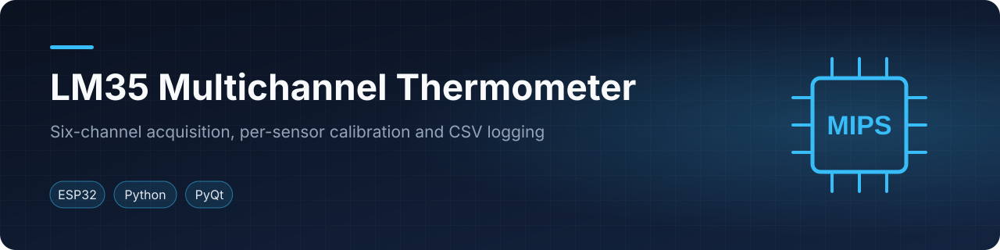

<p align="center"></p>

<p align="center">    </p>
<p align="center"><a href="#english">English</a> · <a href="#español">Español</a></p>

## English

### Overview
This Python desktop application acquires, plots, calibrates and records up to six LM35 temperature sensors read by an ESP32. The ESP32 firmware only streams raw ADC values over a checksummed serial protocol; the PC handles temperature conversion and calibration. Each session stores a raw CSV, JSON metadata, an event log and copies of sensor placement photos. A DEMO mode reproduces the workflow without hardware, and its files are marked `SIMULADO`.

> Nominal temperature is only an approximation. The ESP32 ADC has tolerances and non-linearity: calibrate each sensor against a reference before treating values as measurements.

### Features
- Up to 6 channels (S1-S6), any combination, with a bit mask so unselected GPIOs are never sampled.
- Configurable sampling rate (default 100 Hz per sensor, 921600 baud); the GUI estimates the serial budget and rejects out-of-range settings. The protocol reports lost frames and late samples.
- Live plot (10 s window, 5 Hz refresh), frozen on stop, then zoom and pan over the whole recorded session. Causal moving-average smoothing (1-1000 samples) applies to the plot only; the CSV always stores raw ADC and temperature.
- Per-sensor least-squares calibration (`temperature_C = slope * raw_ADC + offset`) with live capture, manual points, import/export and recalculation of a raw CSV into a new file.
- Session traceability: raw CSV, `*_session.json`, `*_eventos.log` and per-session `photos/`.
- Cleanup tools for sessions, calibrations or all data, blocked during acquisition.

### Wiring
| Channel | ESP32 GPIO | ADC |
|---|---:|---|
| S1 | 32 | ADC1 |
| S2 | 33 | ADC1 |
| S3 | 34 | ADC1 |
| S4 | 35 | ADC1 |
| S5 | 36 (VP) | ADC1 |
| S6 | 39 (VN) | ADC1 |

Power each LM35 from **5 V** (it needs 4-30 V), connect its output to the assigned GPIO and share **GND** with the ESP32. Check the datasheet for your package pinout. The GPIO must never see more than 3.3 V; the LM35 output (10 mV/°C) stays below that in normal use. Use an isolated supply for lab setups and keep sensors and wires isolated from energized parts.

### Quick start
Requires Python 3.10 or later (Windows scripts provided).

```powershell
.\instalar.bat   # creates a local .venv and installs requirements
.\iniciar.bat    # starts the GUI
```

1. Select the serial port, or enable **Modo DEMO**.
2. Enter a free-text experiment label.
3. Tick the channels to sample, name each sensor and optionally attach a placement photo.
4. Press **Iniciar**. Changing channels, label, names or photos during acquisition cleanly closes the session and opens a new one.

Firmware (`esp32dev`, 921600 baud):

```powershell
pio run -d firmware
pio run -d firmware -t upload --upload-port COM3
```

Or open `firmware/lm35_stream/lm35_stream.ino` in the Arduino IDE (esp32 by Espressif Systems). Do not keep a serial monitor open while the app runs.

### Calibration
Use the **Calibración por sensor** tab: choose a sensor, enter the real temperature and press **Append medición de calibración**; during acquisition it pairs the reference with the average ADC of the last second. You can also add manual points, delete points, disable or reset the calibration of one sensor, and recalculate a raw CSV. Wait for thermal stability and use at least three points across the working range (minimum two). An IR gun measures surface temperature, so account for emissivity. The firmware uses 6 dB attenuation (useful range about 0.15-1.75 V) and the nominal conversion assumes a fixed 2.2 V full scale.

### Data format
Serial protocol (text lines, `PAYLOAD*HH`, HH = XOR checksum in hex), defined in `lm35/protocol.py`:

```
PC -> ESP32:  PING | CFG,mask,interval_us,1 | START | STOP | STATUS
ESP32 -> PC:  HELLO,fw,boot_id,nmax | ACK,cmd | NAK,cmd,reason
              D,seq,t_us,ovr,mask,ch1,adc1,...,chN,adcN
```

Each session lives under `datos/sesiones/`:
- `*_raw.csv`: one row per enabled channel and frame (ADC, °C, GPIO, name, label, relative photo path, calibration revision)
- `*_session.json`: configuration, channels, calibration/name snapshot, photos, statistics
- `*_eventos.log`: resets, losses, calibration changes, close
- `photos/`: per-session copies of the attached images

### Tests
```powershell
python -m unittest discover -s tests -t . -v
python -m lm35 demo --seconds 4 --inject-faults
python -m lm35 smoke --seconds 1.5
python -m tests.validar_hardware --port COM3   # with a real board; floating inputs are not temperature data
```
The suite covers calibration, cleanup, history, protocol, recalculation, smoothing, the worker thread and a GUI smoke test.

### Repository layout
```
lm35/       Python package (gui, worker, protocol, calibration, recorder, recalc, demo)
firmware/   ESP32 sketch and platformio.ini
tests/      unittest suite and hardware validation script
*.bat       Windows install / start / test helpers
```

### Team & credits
Developed by Elías David Álvarez Martínez at Universidad Católica "Nuestra Señora de la Asunción" (Paraguay).

### License
MIT.

---

## Español

### Descripción general
Esta aplicación de escritorio en Python permite adquirir, graficar, calibrar y registrar hasta seis sensores LM35 leídos por un ESP32. El firmware solo transmite valores ADC crudos por un protocolo serie con checksum; la PC realiza la conversión a temperatura y la calibración. Cada sesión conserva un CSV crudo, metadatos JSON, un registro de eventos y copias de las fotos de los sensores. El modo DEMO reproduce el flujo de trabajo sin hardware y marca sus archivos como `SIMULADO`.

> La temperatura nominal es solo una aproximación. El ADC del ESP32 tiene tolerancias y no linealidad: calibre cada sensor con una referencia antes de tratar los valores como mediciones.

### Funciones
- Hasta 6 canales (S1-S6), en cualquier combinación, con una máscara de bits para que nunca se muestreen los GPIO no seleccionados.
- Frecuencia de muestreo configurable (100 Hz por sensor y 921600 baudios de forma predeterminada); la GUI estima el presupuesto serie y rechaza configuraciones fuera de rango. El protocolo informa tramas perdidas y muestras tardías.
- Gráfica en vivo (ventana de 10 s, actualización a 5 Hz), congelada al detenerse y luego navegable con zoom y desplazamiento por toda la sesión registrada. El suavizado causal por media móvil (1-1000 muestras) solo afecta la gráfica; el CSV siempre conserva el ADC y la temperatura sin suavizar.
- Calibración por mínimos cuadrados para cada sensor (`temperature_C = slope * raw_ADC + offset`), con captura en vivo, puntos manuales, importación/exportación y recálculo de un CSV crudo en un archivo nuevo.
- Trazabilidad de sesión: CSV crudo, `*_session.json`, `*_eventos.log` y `photos/` por sesión.
- Herramientas para limpiar sesiones, calibraciones o todos los datos, bloqueadas durante la adquisición.

### Conexión
| Canal | GPIO ESP32 | ADC |
|---|---:|---|
| S1 | 32 | ADC1 |
| S2 | 33 | ADC1 |
| S3 | 34 | ADC1 |
| S4 | 35 | ADC1 |
| S5 | 36 (VP) | ADC1 |
| S6 | 39 (VN) | ADC1 |

Alimente cada LM35 con **5 V** (requiere 4-30 V), conecte su salida al GPIO asignado y comparta **GND** con el ESP32. Consulte la hoja de datos para verificar el pinout del encapsulado. El GPIO nunca debe recibir más de 3,3 V; en condiciones normales, la salida del LM35 (10 mV/°C) permanece por debajo de ese valor. En montajes de laboratorio use una fuente aislada y mantenga sensores y cables separados de las partes energizadas.

### Inicio rápido
Requiere Python 3.10 o posterior (se incluyen scripts para Windows).

```powershell
.\instalar.bat   # crea un .venv local e instala los requisitos
.\iniciar.bat    # inicia la GUI
```

1. Seleccione el puerto serie o active **Modo DEMO**.
2. Escriba una etiqueta de texto libre para el experimento.
3. Marque los canales que se muestrearán, asigne un nombre a cada sensor y, si lo desea, adjunte una foto de su ubicación.
4. Presione **Iniciar**. Si se cambian los canales, la etiqueta, los nombres o las fotos durante la adquisición, la sesión se cierra correctamente y se abre una nueva.

Firmware (`esp32dev`, 921600 baudios):

```powershell
pio run -d firmware
pio run -d firmware -t upload --upload-port COM3
```

También puede abrir `firmware/lm35_stream/lm35_stream.ino` en Arduino IDE (esp32 by Espressif Systems). No mantenga abierto un monitor serie mientras se ejecuta la aplicación.

### Calibración
Use la pestaña **Calibración por sensor**: elija un sensor, ingrese la temperatura real y presione **Append medición de calibración**; durante la adquisición, se empareja la referencia con el ADC promedio del último segundo. También se pueden agregar puntos manuales, eliminar puntos, desactivar o restablecer la calibración de un sensor y recalcular un CSV crudo. Espere la estabilidad térmica y use al menos tres puntos distribuidos por el rango de trabajo (mínimo dos). Una pistola IR mide temperatura superficial, por lo que debe considerarse la emisividad. El firmware usa atenuación de 6 dB (rango útil aproximado de 0,15-1,75 V) y la conversión nominal supone una escala completa fija de 2,2 V.

### Formato de datos
Protocolo serie (líneas de texto, `PAYLOAD*HH`, HH = checksum XOR en hexadecimal), definido en `lm35/protocol.py`:

```
PC -> ESP32:  PING | CFG,mask,interval_us,1 | START | STOP | STATUS
ESP32 -> PC:  HELLO,fw,boot_id,nmax | ACK,cmd | NAK,cmd,reason
              D,seq,t_us,ovr,mask,ch1,adc1,...,chN,adcN
```

Cada sesión se guarda en `datos/sesiones/`:
- `*_raw.csv`: una fila por canal habilitado y trama (ADC, °C, GPIO, nombre, etiqueta, ruta relativa de la foto, revisión de calibración)
- `*_session.json`: configuración, canales, instantánea de calibración/nombres, fotos, estadísticas
- `*_eventos.log`: reinicios, pérdidas, cambios de calibración, cierre
- `photos/`: copias por sesión de las imágenes adjuntas

### Pruebas
```powershell
python -m unittest discover -s tests -t . -v
python -m lm35 demo --seconds 4 --inject-faults
python -m lm35 smoke --seconds 1.5
python -m tests.validar_hardware --port COM3   # con una placa real; las entradas flotantes no son datos de temperatura
```
La suite cubre calibración, limpieza, historial, protocolo, recálculo, suavizado, el hilo de trabajo y una prueba de humo de la GUI.

### Estructura del repositorio
```
lm35/       Paquete Python (gui, worker, protocol, calibration, recorder, recalc, demo)
firmware/   Sketch ESP32 y platformio.ini
tests/      Suite unittest y script de validación de hardware
*.bat       Auxiliares de instalación / inicio / pruebas para Windows
```

### Equipo y créditos
Desarrollado por Elías David Álvarez Martínez en la Universidad Católica "Nuestra Señora de la Asunción" (Paraguay).

### Licencia
MIT.
